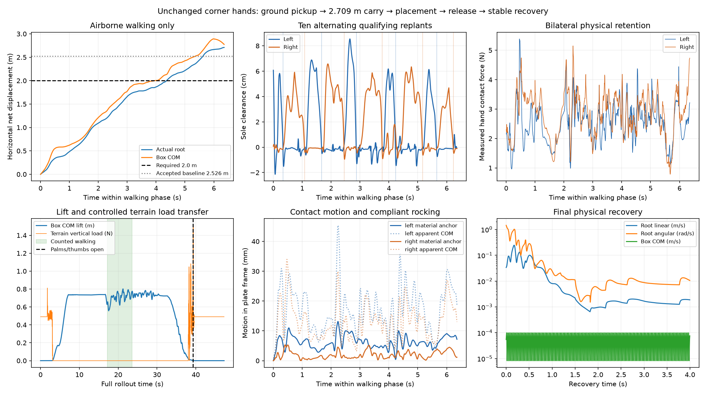

**SUCCESS — the existing corner hands complete ground pickup, 2.709 m of actual airborne walking carry, controlled placement, physical opening, clean withdrawal, and stable recovery in one continuous MuJoCo rollout.**

The selected execution is [corner_recovered/rollout.npz](corner_recovered/rollout.npz), with its [standalone MuJoCo model](corner_recovered/rollout_model.mjb) and [complete video](corner_recovered/rollout.mp4). It contains 9,461 controls at 200 Hz, lasting 47.305 s. The video has 2,365 frames at 50 Hz. The independently replayed maximum qpos and qvel discrepancies are both exactly zero.

The corner geometry, actuator limits, box geometry, 0.050 kg box mass, inertia, collision masks, and contact parameters are unchanged. This integration uses the existing physically actuated palm carriages, forks, opposition thumbs, and swivels. No new hand architecture was introduced. All real object motion results from finite actuator commands and MuJoCo contact dynamics.

**Measured outcome.**

| Requirement / measurement | Selected execution |
|---|---:|
| Initial terrain support | Yes; initial vertical terrain load 0.490464 N |
| Maximum box COM lift | 0.801573 m |
| Counted airborne walking interval | 17.245–23.605 s |
| Actual root horizontal net displacement in that interval | **2.708868 m** |
| Box COM horizontal displacement in the same interval | 2.774776 m |
| Total box COM horizontal displacement, initial to final | 2.826273 m |
| Consecutive alternating qualifying replants | **10: L–R–L–R–L–R–L–R–L–R** |
| Qualifying swing clearances | 46.9–85.5 mm |
| Minimum left / right hand contact force during walking | 0.9628 / 0.7841 N |
| Minimum COM lift during walking | 0.557228 m |
| Object-terrain contact during counted walking | 0 steps |
| Forbidden non-end-effector object impulse, entire execution | **0 N·s** |
| Robot self / invalid robot-terrain impulse | **0 / 0 N·s** |
| Terrain reaches sustained >70% box weight support | 38.535 s |
| Full palm/thumb opening command begins | 39.300 s |
| Terrain load when opening begins | 0.438641 N, 89.4% of box weight |
| Last end-effector contact | 39.565 s |
| Final 1 s terrain load, mean | 0.490500 N |
| Final 1 s maximum robot root linear / angular speed | 0.001947 m/s / 0.013450 rad/s |
| Final 1 s maximum box COM linear / angular speed | 0.0000990 m/s / 0.000637 rad/s |
| Final root height / torso tilt | 0.587964 m / 17.36° |
| Exact independent qpos / qvel replay error | **0 / 0** |

Walking distance excludes acquisition, preparation, braking, and placement. Replants require at least 60 ms unloaded, 20 mm measured sole clearance, 120 mm relocation of that same foot, and loaded support before and after touchdown. Each of the ten measured events exceeds these gates. Event times, forces, clearances, and distances are in [task_metrics.json](corner_recovered/task_metrics.json).

The box is airborne continuously from 3.120 to 38.080 s. Aggregate hand contact force remains nonzero throughout that interval, with a minimum of 2.013 N. At initial terrain touchdown its COM vertical velocity is −0.0962 m/s. A brief terrain separation during settling at 38.330–38.375 s occurs while the hands retain the box. The controller waits for sustained terrain load transfer before full opening. Terrain support remains continuous after the last hand contact. This is controlled placement, including physical terrain load transfer, rather than a released airborne drop.

Final carriage positions are approximately −25 mm, fork angles 0.016 rad, and thumb angles approximately zero. Both hands remain clear after withdrawal. Both feet carry load during the final second; minimum left/right vertical forces are 189.0 / 144.0 N. Recovery ends in a stable crouched stance.

**The physical grasp is compliant.**

The box rocks within the grasp during alternating support. Peak box orientation change relative to the left/right moving palm plates is 14.52° / 9.68°; the corresponding final changes at walking completion are 5.88° / 3.99°. Apparent COM motion in those plate frames reaches 45.37 / 33.97 mm. COM motion includes the lever-arm effect of rocking about the grasp contact.

Following a fixed box material point initialized at each palm's loaded contact center gives peak tangential motion of **13.14 / 5.31 mm**, ending at **7.19 / 1.17 mm**. These are bounded contact-local excursions, not a claim of zero slip or a rigid attachment. There is no progressive extraction, spinning, ejection, ballistic interval, or loss of physical support. The box remains captured through all ten support transitions, braking, the stationary post-walk hold, and lowering. The bounded rocking and settling are the basis for accepting grasp retention in this execution. Full measurements and the reconstruction method are in [grasp_audit.json](corner_recovered/grasp_audit.json).



**Integration changes.**

The existing corner pickup and verified loaded hold supply the acquisition prefix. A physical foot-pivot transition makes the stance compatible with walking. SONIC uses recomputed native forward-kinematics references with the loaded waist yaw preserved, active waist roll/pitch, and a 0.04 rad hip-abduction offset with matching ankle-roll adjustment. The existing native walking cycle is reused twice to obtain the required actual displacement. Loaded arm commands retain their grasp preload while gravity compensation follows the actual configuration.

Stopping and lowering use a bounded foot-wrench allocator to compute native joint torques. Its unilateral, friction, and sole-moment bounds prevent the previous unconstrained allocation from demanding large ankle moments at a nearly unloaded foot. These computed wrenches are **never applied as external forces or constraints**. MuJoCo still determines every real foot and hand contact, and actuator effort limits remain enforced.

Placement advances the box 100 mm early in the descent, coordinates pelvis height with hand lowering, and includes native thigh-to-torso clearance. The forks fold while palms and thumbs retain the box. Preload decreases as terrain acquires the load; full hand opening follows sustained terrain support. After withdrawal, `recover.py` captures the actual support stance and settles it with the bounded controller while keeping the fingers open. This replaces the old pose-tracking recovery that eventually drifted into the grounded box.

Every continuation reconstructs solver history by replaying the entire control prefix from the original initial state. It then appends actuator controls. No saved post-pickup object or robot state is transplanted into the real simulation. The recovery handoff occurs after control 8,661; [controller_handoff.json](corner_recovered/controller_handoff.json) verifies identical controls, qpos, and qvel through that boundary. The rejected later tail of `corner_place_support` remains preserved.

**Mechanical scale and accepted baseline comparison.**

| Measurement | Accepted oversized frame | Existing corner hands used here |
|---|---|---|
| Mechanism | Common object-spanning clamp frame | Two independent wrist-mounted carriages, forks, opposing thumbs and swivels |
| Complete mechanism mass | 301 g | 341 g per hand; 682 g pair |
| Closed maximum wrist-to-collision reach | 665 mm | 394 mm per hand |
| Neutral maximum wrist-to-collision reach | 812 mm | 314 mm per hand |
| Closed collision envelope | 479 × 459 × 652 mm, common frame axes | Left 339 × 158 × 229 mm; right 339 × 179 × 229 mm, respective wrist axes |
| Physical grip / original box | Yes / yes | Yes / yes |
| Actual retained walking root displacement | 2.526 m | **2.709 m** |
| Alternating qualifying replants | 5 | **10** |
| Controlled placement, physical release and recovery | Verified baseline | Verified selected rollout |

The compact pair has shorter wrist leverage and separate physical actuators, at greater total hand mass and with more grasp compliance. Palm plates are 120 × 130 × 10 mm; fingers are 150 mm with 80 mm toes; carriage stroke is 60 mm. They are the pre-existing research hands, including their complete mounts and appendages. Dimensions are in [mechanical_dimensions.json](corner_recovered/mechanical_dimensions.json). The original body-frame largebox AABB remains **0.473572 × 0.461602 × 0.409559 m**.

**Verification and evidence.**

For publication, the documented raw-control physics replay with full video rendering was run once again, followed by the existing task audit. It reproduced zero qpos/qvel discrepancy, zero forbidden/self/invalid terrain impulse, 2.708868 m of walking, ten consecutive alternating replants, and `SUCCESS` with no failed task gates. No experiment or optimization was run.

- [Independent replay and disjoint per-geometry impulse attribution](corner_recovered/rollout_verification.json), [200 Hz physics trace](corner_recovered/rollout_verification_trace.npz), and [locomotion force/clearance trace](corner_recovered/rollout_locomotion_trace.npz).
- [Task measurements and individual replants](corner_recovered/task_metrics.json), [placement/contact detail](corner_recovered/contact_and_placement.json), and [model integrity](corner_recovered/physical_integrity.json).
- [Full video](corner_recovered/rollout.mp4) and [visual review coverage](corner_recovered/visual_review.json). The original accepted rendering was completely reviewed: its first 1,585 decoded frames were pixel-identical to the already inspected `corner_bounded_hold` video; recovered sheets 24–36 were directly inspected across the overlap and all remaining frames. The publication verification regenerated the video from the same exact physics trajectory. The historical pixel-equivalence record describes that original review, not an assertion about identical encoding after rerendering. The frame atlases remain local and are excluded from Git.

The inherited partial-result verifier always writes `success: false`. Its `full_valid` additionally imposes a legacy torso-tilt limit of 45°, which acquisition slightly exceeds and the physically supported deep placement crouch exceeds (maximum 65.42°). Those fields are preserved unchanged. They are not the task acceptance decision. The requested task does not prescribe that tilt limit; the relevant full-execution evidence is exact replay, zero forbidden/self/invalid terrain impulse, retained walking, supported placement, opening, and final stability. [task_assessment.json](corner_recovered/task_assessment.json) records the acceptance against those requirements and the measured grasp compliance.

All object geometry/contact fields match the accepted oversized model exactly. All physical geometry, body/joint poses, actuator gains, control ranges, and effort caps match the existing corner pickup model. Equalities, disabled physics flags, object actuators, and applied external forces are zero. Nonzero object impulses are attributed to terrain and the physical hand geometries; the small hand-housing contacts are included explicitly in the per-geometry report.

**Reproduction in the existing environment.**

From `/home/learning/Documents/orcs-fork`, using the existing `.venv` with MuJoCo **3.8.1**, replay the complete execution and regenerate its video without SONIC, CUDA, policy inference, or generation controllers:

```bash
OPENBLAS_NUM_THREADS=1 MUJOCO_GL=egl .venv/bin/python \
  scripts/corner_hands_v1/verify_physics.py \
  logs/compact_integration_v2/corner_recovered/rollout.npz --video

OPENBLAS_NUM_THREADS=1 .venv/bin/python \
  scripts/compact_integration_v2/audit.py \
  logs/compact_integration_v2/corner_recovered
```

Expected: qpos/qvel errors exactly zero, forbidden object and invalid terrain impulses zero, root walking displacement 2.708868 m, ten consecutive alternating replants, terrain transfer before opening, and the final stability values above. The raw verifier's legacy Boolean fields have the meaning described above.

The exact raw-control replay needs only the versioned final rollout/model and verifier sources. The audit's historical hand-geometry comparison also reads the preserved local `logs/corner_hands_v1/pickup3_model.mjb`. That duplicate intermediate model is excluded from Git; its measured comparison results are included in `physical_integrity.json`. Regeneration examples below likewise use local historical prefixes and `logs/corner_hands_v1/reach3.npz`, which are excluded as intermediate research artifacts. No pretrained weights are added by this publication.

Regenerate lowering and recovery from the preserved full pickup/walk/brake/hold prefix with fresh output tags:

```bash
OPENBLAS_NUM_THREADS=1 .venv/bin/python scripts/compact_integration_v2/place.py \
  --source logs/compact_integration_v2/corner_bounded_hold/rollout.npz \
  --tag lowering_repro --forward .10 --fork-release-height .085

OPENBLAS_NUM_THREADS=1 .venv/bin/python scripts/compact_integration_v2/recover.py \
  --source logs/compact_integration_v2/lowering_repro/rollout.npz \
  --tag complete_repro
```

`place.py` now ends at the verified withdrawal boundary before handing off to the measured support hold. That boundary is exactly the prefix used by the selected recovered execution. To regenerate walking itself from the preserved parallel-foot pickup/hold prefix:

```bash
OPENBLAS_NUM_THREADS=1 MUJOCO_GL=egl .venv/bin/python \
  scripts/compact_integration_v2/walk.py \
  --source logs/compact_integration_v2/corner_parallel/rollout.npz \
  --tag walking_repro --waist-mode yaw --abduction .04 --repetitions 2
```

The earlier successful stages and rejected diagnostics remain in their original local directories. This publication selects the successful compact-hand source files and the final execution's essential evidence. Duplicate intermediate rollouts/models, rejected variants, frame atlases, and pretrained weights are excluded. The committed oversized baseline `abf0917d6e7e1a001323c6fefcf38c4f21eb4295` remains the parent baseline. No canonical-checkout inspection, reset, deletion, cleaning, controller refinement, or additional experiment was performed for publication.
